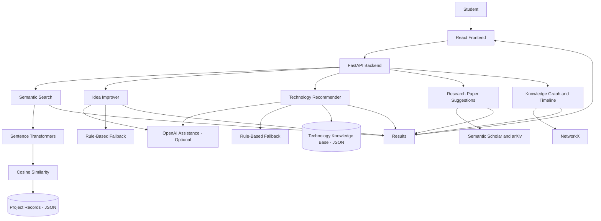

<div align="center">

# 🧠 Project Ahaa

### AI-Powered Student Project Discovery Platform

**Discover existing ideas. Improve new ones. Build with direction.**

<p>
  
  
  
  
</p>

</div>

---

## 📌 Table of Contents

- [Overview](#-overview)
- [Problem Statement](#-problem-statement)
- [What Project Ahaa Does](#-what-project-ahaa-does)
- [Key Features](#-key-features)
- [How It Works](#-how-it-works)
- [System Architecture](#-system-architecture)
- [Technology Stack](#-technology-stack)
- [AI Capabilities and API-Key Options](#-ai-capabilities-and-api-key-options)
- [Data Storage](#-data-storage)
- [Why This Approach](#-why-this-approach)
- [Strengths](#-strengths)
- [Future Improvements](#-future-improvements)
- [Conclusion](#-conclusion)

---

## 🌟 Overview

**Project Ahaa** is an AI-powered, web-based platform that helps students discover existing academic and technical projects, evaluate new ideas, and plan their implementations more effectively.

Students often come up with project ideas without knowing whether similar work already exists, which technologies would suit the problem, or how the idea could be extended. Project Ahaa addresses this challenge by bringing project discovery, semantic similarity matching, idea improvement, technology recommendations, research-paper discovery, and knowledge-graph visualization into one place.

In simple terms, it acts as a **project discovery and planning assistant**. A student can enter an idea or search for a topic and explore related projects, possible improvements, suitable technologies, and relevant research.

## 🎯 Problem Statement

Students may spend considerable time selecting a project topic, only to discover later that a similar project has already been developed. They may also find it difficult to identify useful extensions, choose an appropriate technology stack, or locate research that can support their work.

Project Ahaa aims to make this process easier by helping students:

- Find projects that are semantically related to a new idea.
- Understand how their idea compares with existing work.
- Identify possible improvements and extensions.
- Explore technologies relevant to the problem.
- Discover related academic research.
- Visualize connections between projects, domains, and technologies.

The goal is not simply to provide another keyword search page. It is to support **better-informed project selection and planning**.

## 💡 What Project Ahaa Does

Project Ahaa brings together three main capabilities:

1. **Project discovery:** searches a collection of project records and identifies related ideas using text embeddings and cosine similarity.
2. **AI-assisted guidance:** helps improve project ideas and recommends technologies, using OpenAI-powered suggestions when configured and rule-based fallbacks when it is not.
3. **Knowledge exploration:** connects projects, technologies, domains, and research references through visual graph and timeline views.

## 🚀 Key Features

| Feature | What it does | Why it is useful |
|---|---|---|
| **Project Search and Discovery** | Lets users browse and search the available project collection. | Makes existing work easier to find. |
| **Semantic Similarity Matching** | Uses Sentence Transformers embeddings and cosine similarity to find meaningfully related project descriptions. | Finds related ideas even when they use different wording. |
| **Idea Improver** | Suggests ways to refine, extend, or strengthen a project concept. | Helps students move from a broad idea to a more focused proposal. |
| **Technology Recommender** | Suggests relevant frameworks, tools, and libraries for a project idea. | Helps with early technology-stack decisions. |
| **Research Paper Suggestions** | Retrieves related research references using services such as Semantic Scholar and arXiv. | Helps students explore existing academic work. |
| **Knowledge Graph** | Visualizes relationships between projects, technologies, and domains. | Makes connections across the project collection easier to understand. |
| **Timeline View** | Presents related project ideas in a timeline-oriented view. | Helps users explore how related ideas have developed over time. |

## 🔄 How It Works

A typical interaction follows this flow:

1. **Enter an idea:** The student opens the React application and enters a project description, concept, or keyword.
2. **Send the request:** The frontend sends the request to the FastAPI backend through an API call.
3. **Process the request:** The backend routes the request to the relevant module, such as semantic search, idea improvement, or technology recommendation.
4. **Generate results:** The selected module processes the input using local NLP logic, configured AI assistance, stored project data, or an external research service, as appropriate.
5. **Return the response:** The backend sends the results to the frontend.
6. **Explore the results:** The interface presents related projects, recommendations, research references, and graph or timeline visualizations.

### Example: Finding Similar Projects

When a student enters a project idea, the semantic search component converts the text into an embedding using a locally running Sentence Transformers model. The system compares the representation with project data using cosine similarity and returns the most relevant matches. This makes it possible to discover related work even when the wording is not identical.

## 🏗️ System Architecture

Project Ahaa follows a modular, three-layer architecture.

| Layer | Responsibility |
|---|---|
| **Presentation Layer** | The React frontend handles user interaction and displays search results, recommendations, graphs, and timeline views. |
| **Application Layer** | The FastAPI backend exposes API endpoints, validates requests, coordinates application logic, and connects the frontend to the feature modules. |
| **Data Layer** | JSON files store project records and the technology knowledge base used by the prototype. |

### Architecture Flow



The backend acts as the coordinator, while individual Python modules keep feature logic separated. This makes the prototype easier to understand, maintain, and extend.

## 🧰 Technology Stack

The application combines frontend development, API development, natural-language processing, data handling, and graph-based visualization.

### Frontend

| Technology | Purpose |
|---|---|
| **React** | Builds the interactive user interface. |
| **React DOM** | Renders the React application in the browser. |
| **Axios** | Sends HTTP requests between the frontend and backend. |
| **React Scripts** | Supports the frontend development and build workflow. |

### Backend

| Technology | Purpose |
|---|---|
| **FastAPI** | Defines API endpoints and handles HTTP requests. |
| **Uvicorn** | Runs the FastAPI application as an ASGI server. |
| **Pydantic** | Validates request data and defines data schemas. |
| **Requests** | Communicates with external services such as Semantic Scholar and arXiv. |

### AI, NLP, and Data Processing

| Technology | Purpose |
|---|---|
| **Sentence Transformers** | Generates local text embeddings that capture the semantic meaning of project descriptions. |
| **Scikit-learn** | Provides cosine-similarity calculations for comparing vector representations. |
| **NumPy** | Supports numerical and vector operations. |
| **NetworkX** | Builds and manages relationships in the project knowledge graph. |

## 🤖 AI Capabilities and API-Key Options

A key design goal of Project Ahaa is to keep its core discovery workflow accessible without requiring a paid LLM API key.

| Component | Without an OpenAI API key | With an OpenAI API key |
|---|---|---|
| **Semantic embeddings** | Runs locally using Sentence Transformers. | Still runs locally; an OpenAI key is not required for embeddings. |
| **Idea Improver** | Uses a rule-based fallback system. | Can provide LLM-powered suggestions. |
| **Technology Recommender** | Uses a rule-based fallback system. | Can provide LLM-powered recommendations. |

### Optional OpenAI Configuration

To enable LLM-powered suggestions, configure the `OPENAI_API_KEY` environment variable in the backend environment:

```env
OPENAI_API_KEY=your_openai_api_key
```

Keep API keys private. Do not commit real credentials to the repository. The OpenAI integration is optional; the rule-based fallback systems allow the Idea Improver and Technology Recommender to work without it.

> **Note:** Sentence Transformers runs locally and does not require an OpenAI API key. Research-paper discovery uses external services such as Semantic Scholar and arXiv, so those lookups depend on internet connectivity and the availability of those services.

## 🗂️ Data Storage

The current prototype uses lightweight **JSON files** for:

- Project records used by the discovery and similarity-matching features.
- Technology knowledge-base information used by the recommender.

This keeps the setup relatively simple for local development and academic demonstration. A dedicated database could be introduced later as the collection and number of users grow.

## 🧩 Why This Approach

The architecture is intentionally modular and lightweight because Project Ahaa is designed as an academic prototype and demonstration platform.

- **Separation of concerns:** frontend, API coordination, and feature-specific logic are kept in distinct layers or modules.
- **Local semantic processing:** Sentence Transformers provides embedding generation without requiring a hosted embedding API.
- **Practical storage:** JSON files keep the initial data layer easy to work with.
- **Graceful feature availability:** rule-based fallbacks keep idea improvement and technology recommendations available when an OpenAI API key is not configured.
- **Extensibility:** the modular backend makes it easier to add a database, authentication, or additional recommendation modules in the future.

## ✅ Strengths

- Combines project discovery and project-planning guidance in one application.
- Uses semantic similarity rather than relying only on exact keyword matches.
- Provides idea-improvement and technology-recommendation capabilities.
- Connects project exploration with external academic research sources.
- Visualizes relationships through a knowledge graph and timeline.
- Keeps embeddings local and supports rule-based fallbacks when OpenAI is not configured.
- Uses a clear separation between the frontend, backend, and data-processing components.

## 🔮 Future Improvements

The platform can be extended in several ways:

- **Database integration:** replace or supplement JSON storage with a database for more structured and scalable data management.
- **User authentication:** allow students to create accounts and manage their project ideas.
- **Improved recommendation quality:** refine similarity ranking and recommendation logic as the project collection grows.
- **Interface enhancements:** continue improving usability, accessibility, and responsive layouts.
- **Configuration and security:** centralize application settings and manage secrets through environment variables rather than hardcoding them.
- **External-service reliability:** improve handling, caching, and error reporting for research-paper API requests.

## 🎓 Conclusion

Project Ahaa brings together AI, web development, natural-language processing, and data visualization to make student project discovery more informed and accessible. By finding semantically related projects, suggesting ways to improve ideas, recommending technologies, surfacing research references, and visualizing relationships, it supports students throughout the early stages of project planning.

Its modular architecture, local embedding workflow, lightweight JSON data layer, and optional OpenAI integration make it a practical foundation for a student-focused project discovery platform.

---

<div align="center">

**Project Ahaa — Turn project ideas into better-informed plans.**

</div>
